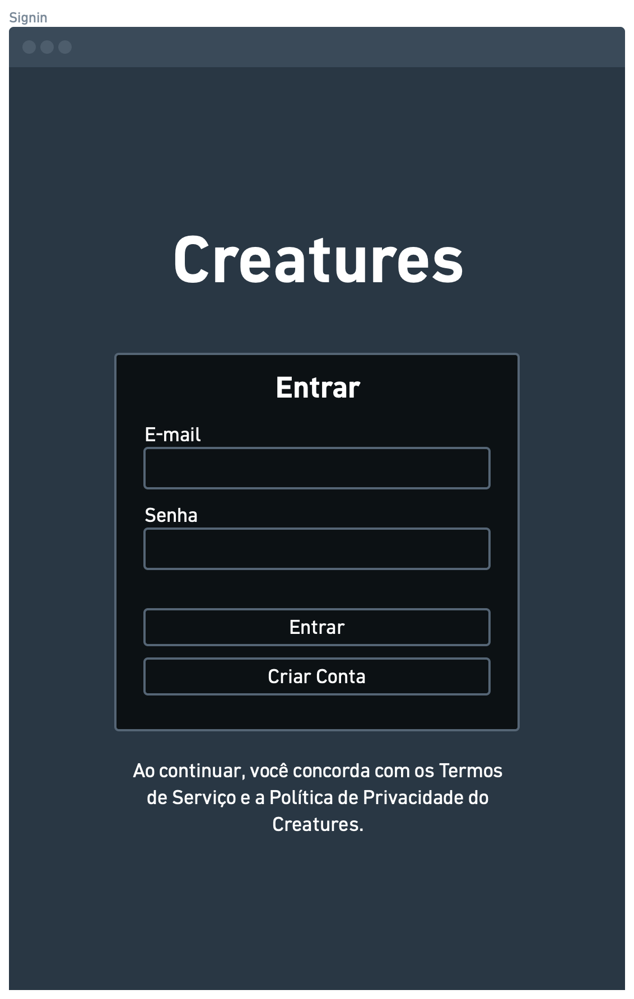
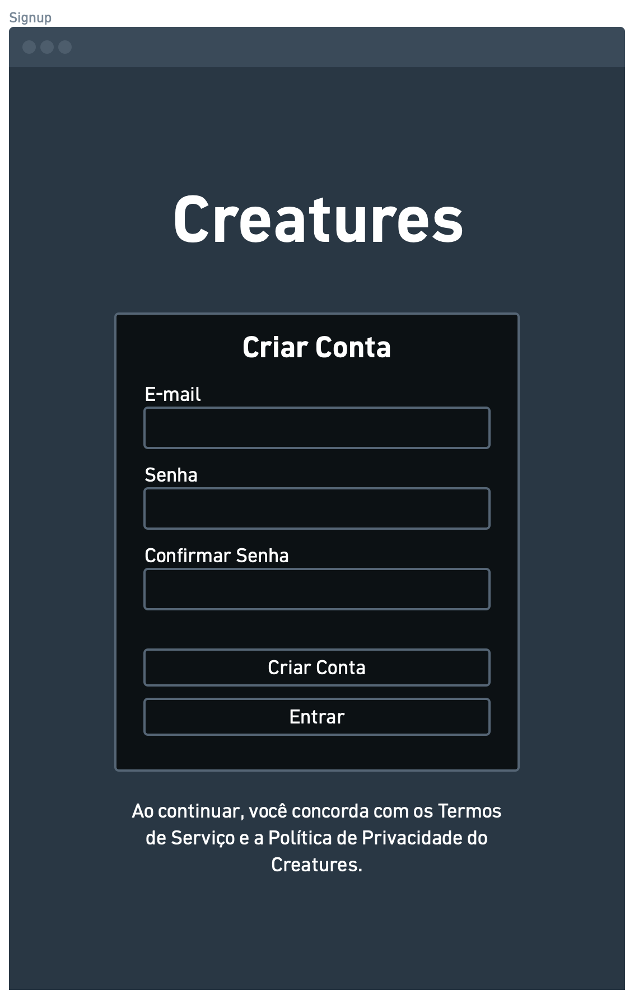
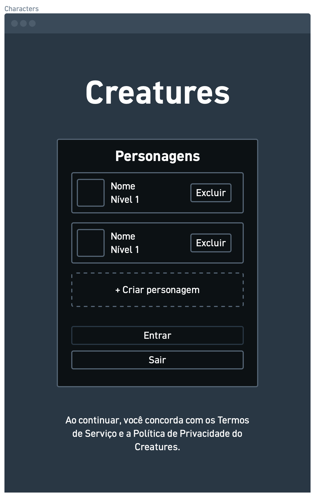
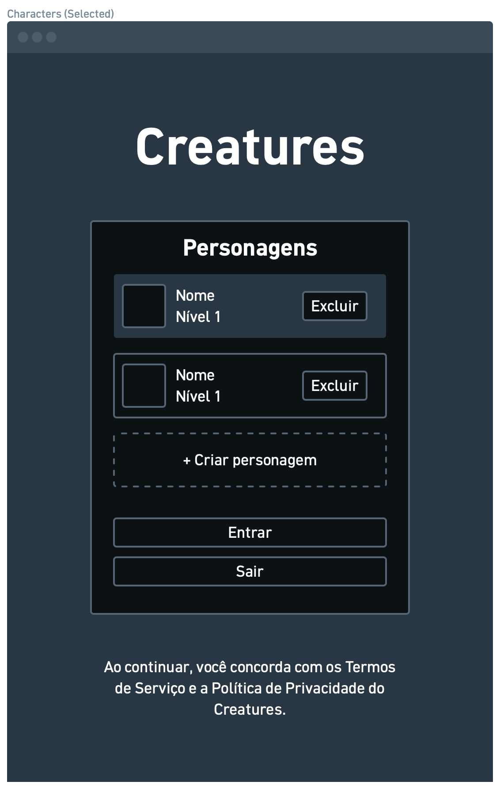
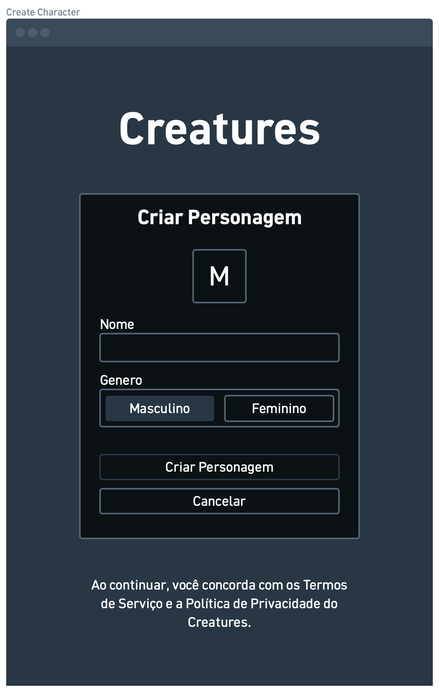
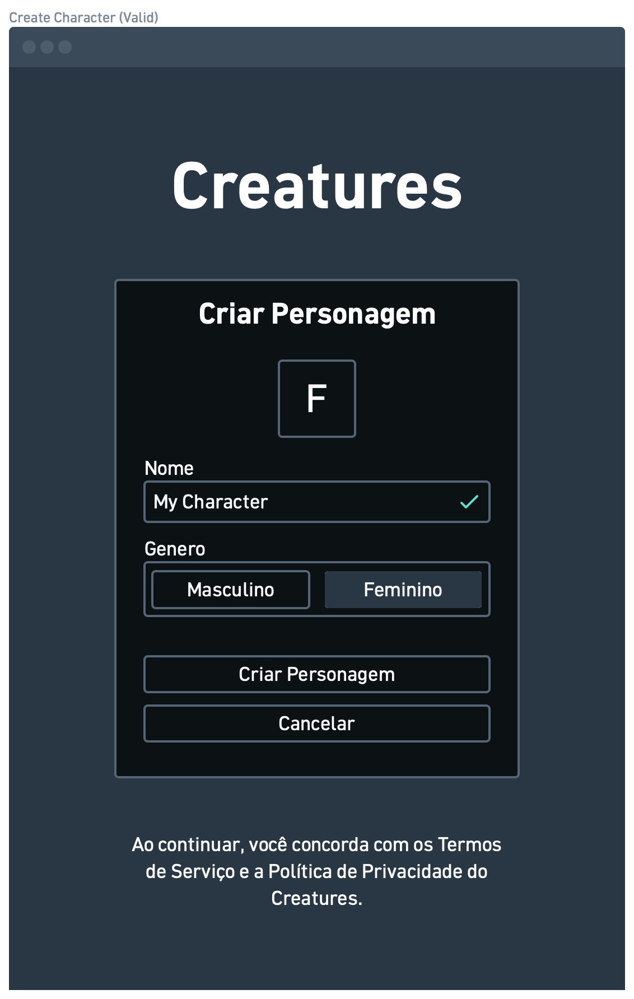
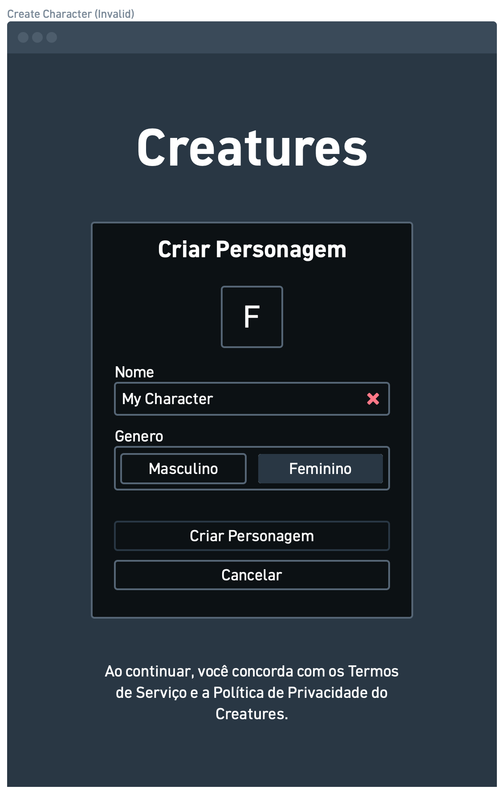

# Autenticação

Este documento cobre todo o processo de autenticação, desde a criação de contas até a criação de personagens.

## Rotas

| Rota              | Tela                                                                | Acesso    |
| ----------------- | ------------------------------------------------------------------- | --------- |
| `/signin`         | [Tela de signin](#tela-de-signin)                                   | Visitante |
| `/signup`         | [Tela de signup](#tela-de-signup)                                   | Visitante |
| `/terms`          | [Tela de termos de serviço](#tela-de-termos-de-serviço)             | Pública   |
| `/privacy`        | [Tela de política de privacidade](#tela-de-política-de-privacidade) | Pública   |
| `/characters`     | [Tela de lista de personagens](#tela-de-lista-de-personagens)       | Protegida |
| `/characters/new` | [Tela de criar personagem](#tela-de-criar-personagem)               | Protegida |
| `/game`           | Tela do jogo                                                        | Protegida |

## Tela de Signin

A tela de acesso ao jogo, com o cartão "Entrar no Jogo": os campos de e-mail e senha, e os botões "Entrar" e "Criar Conta", que leva à [tela de signup](#tela-de-signup).

Se o e-mail ou a senha estiverem incorretos, é exibida sempre a mesma mensagem genérica "E-mail ou senha inválidos.", sem indicar qual dos dois está errado.

Na parte inferior da página é exibida a seguinte frase "Ao continuar, você concorda com os [Termos de Serviço](/terms) e a [Política de Privacidade](/privacy) do Empirage.". Ambos os links redirecionam o usuário para os [termos de serviço](#tela-de-termos-de-serviço) e a [política de privacidade](#tela-de-política-de-privacidade) respectivamente.

## Tela de Signup

A tela de criação de contas, com o cartão "Criar Conta": os campos e-mail, senha e confirmar senha. Os botões são "Criar Conta" e "Entrar", que volta para a [tela de signin](#tela-de-signin).

> Ao realizar o cadastro com sucesso, o usuário já autenticado é redirecionado conforme o [controle de redirecionamento](#controle-de-redirecionamento). Se o e-mail informado já estiver cadastrado, o usuário é redirecionado para a [tela de signin](#tela-de-signin).

Nesse primeiro momento não é necessário confirmação de e-mail.

## Tela de Termos de Serviço

Tela em branco por enquanto.

## Tela de Política de Privacidade

Tela em branco por enquanto.

## Tela de Lista de Personagens

Tela com o cartão "Personagens" e uma lista vertical, um item por personagem. Cada item exibe o avatar disponível, o nome e o nível. Quando a conta não possui personagens, a tela informa que nenhum personagem foi encontrado. O botão "Novo personagem" leva à [tela de criar personagem](#tela-de-criar-personagem).

Cada personagem possui um botão "Selecionar". Ao selecionar um personagem, ele é salvo na sessão persistente do navegador para a conta autenticada e o jogador é redirecionado para `/game`. Essa seleção não representa uma caça ativa e não é persistida no banco como estado do personagem.

Uma caça ativa é representada separadamente por uma linha na tabela de caças. Cada conta pode ter no máximo um personagem caçando. Enquanto houver uma caça ativa, o jogador é direcionado para `/game` e não pode acessar a lista para selecionar outro personagem. A caça permanece ativa mesmo depois do logout ou do fechamento do navegador.

Na parte de baixo da lista ficam os botões "Novo personagem" e "Sair da conta", que encerra a sessão sem remover a seleção persistida. A exclusão de personagens ainda não está implementada nessa tela.

## Tela de Criar Personagem

Tela com o cartão "Criar Personagem", no mesmo formato dos outros formulários de autenticação. Ela exibe o campo de nome e a seleção de gênero entre Masculino e Feminino, sendo Masculino a opção selecionada por padrão.

Na parte inferior ficam dois botões, "Criar" e "Voltar", sendo que "Voltar" está sempre habilitado.

> O nome deve ter entre 3 e 15 caracteres e conter apenas letras (com ou sem acento), espaços, apóstrofos, traços e underscores. Números não são aceitos. Espaços no início ou no fim e dois espaços consecutivos não são permitidos. A validação exibe a mensagem "Apenas letras, espaços, apóstrofo, traços e underscores são permitidos." para o formato e "O nome deve ter entre 3 e 15 caracteres." para o tamanho.

> O nome é único em todo o jogo, e a comparação ignora diferenças de maiúsculas, minúsculas e acentos, ou seja, "Ana", "ana" e "Aná" são considerados o mesmo nome.

> O banco valida a disponibilidade no momento da criação. Se o nome não estiver disponível, o personagem não é criado, o usuário permanece na tela e é exibida a mensagem "Nome indisponível.".

Ao clicar em criar, o personagem é criado no primeiro slot livre da conta, a consulta da lista é invalidada e o usuário é redirecionado para a [tela de lista de personagens](#tela-de-lista-de-personagens).

Cada conta pode ter no máximo 5 personagens. O limite é imposto pela função do banco, que serializa criações concorrentes da mesma conta e retorna um erro quando não há slot livre. Nesse caso, a tela exibe "Você atingiu o limite de 5 personagens.". O redirecionamento preventivo ao acessar a tela ainda não está implementado.

Ao clicar em voltar, o usuário é redirecionado de volta para a [tela de lista de personagens](#tela-de-lista-de-personagens).

## Controle de Redirecionamento

Após uma autenticação ou cadastro bem-sucedido, o sistema verifica primeiro se a conta possui um personagem com caça ativa. Nesse caso, o usuário é redirecionado diretamente para `/game` e a sessão do navegador é sincronizada com esse personagem. Se não houver caça ativa, o sistema verifica o personagem salvo na sessão persistente do navegador: havendo um personagem selecionado, o usuário pode acessar `/game`; caso contrário, é redirecionado para a [tela de lista de personagens](#tela-de-lista-de-personagens).
